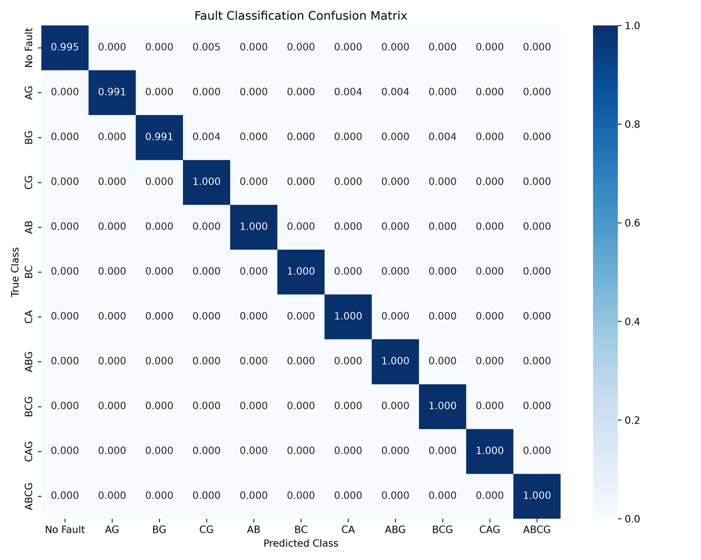
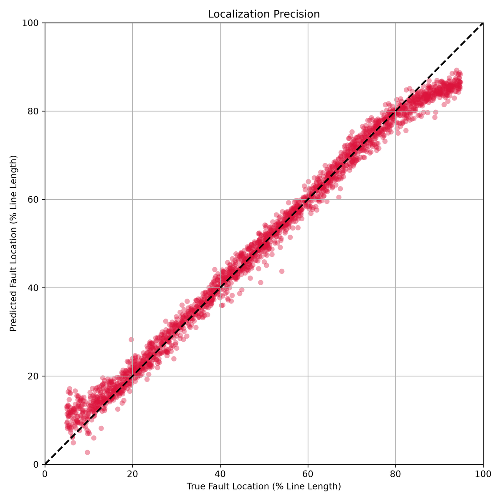
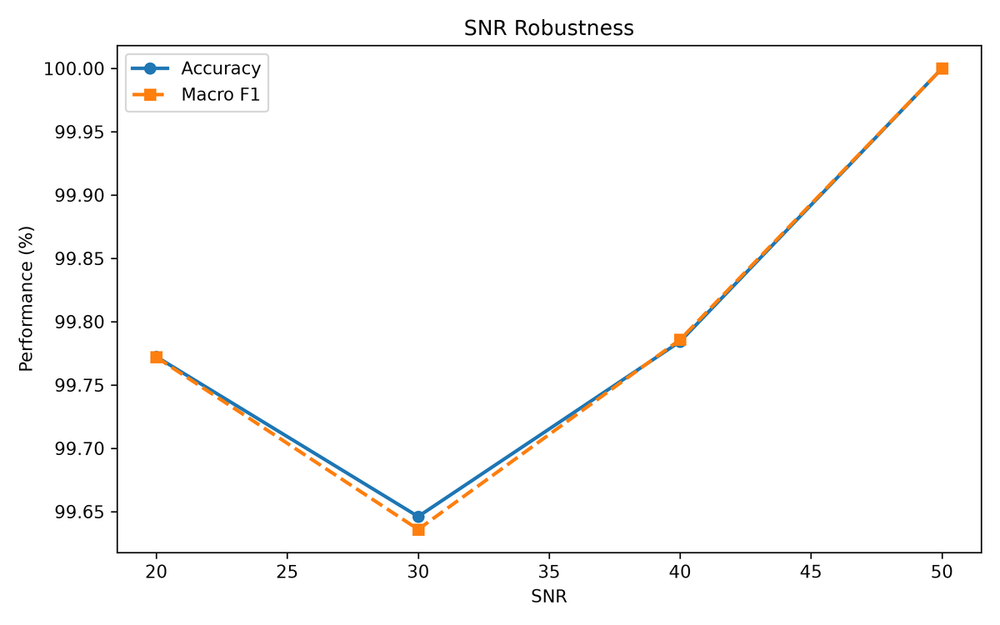
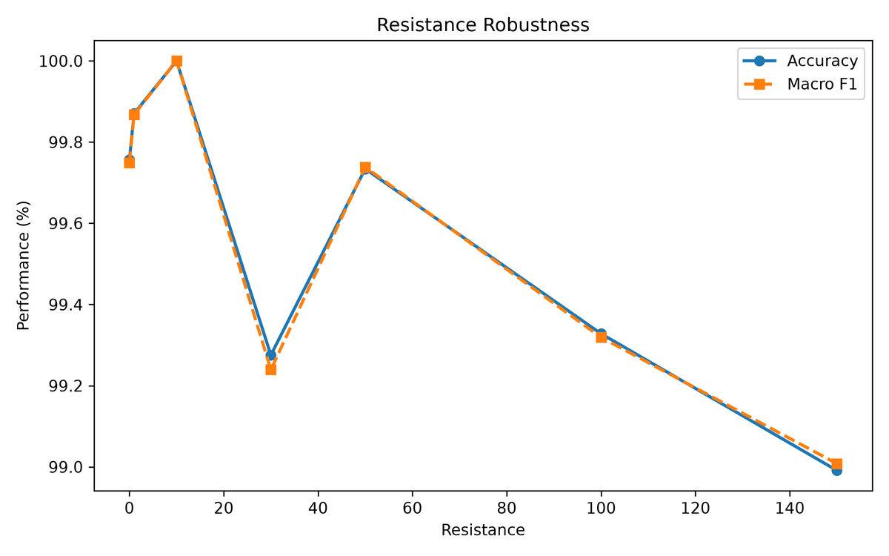

# Intelligent Fault Classification & Localization
### A Hybrid CNN-LSTM Framework for Transmission Line Protection

This project detects, classifies and locates faults in electrical transmission lines. A 1D-CNN extracts features from the three-phase voltage and current signals, an LSTM models how those features evolve over time, and two output heads predict the **fault type** (11 classes) and the **fault location** (as a percentage of the line length). It is evaluated for robustness to noise (SNR) and to fault resistance.

---

## Project Architecture

The workflow has two phases:

1. **Data generation (MATLAB/Simulink):** simulate fault scenarios at different distances, inception angles and fault resistances, with and without harmonics and noise, and save them to an HDF5 file.
2. **Deep-learning model (Python, PyTorch):** a multi-task CNN-LSTM that classifies the fault type and regresses its location.

---

## Technical Workflow

### 1. Data (MATLAB/Simulink)
`simulation/transmission_model_v2.slx` is the power-system model and `simulation/data_generator_v2.m` runs it in batches and writes three-phase voltage (Va, Vb, Vc) and current (Ia, Ib, Ic) signals to HDF5.

**The simulation covers:**
* **Fault types:** 11 states (10 short-circuit types plus normal), with exactly 1,500 runs per class (16,500 in total).
* **Scenarios per class:** 60% clean, 15% with harmonics (3rd, 5th, 7th and 11th, 1% to 5% amplitude), 15% with noise (added at 20, 30, 40 or 50 dB SNR), 10% with both.
* **Inception angle:** random, 0° to 360°, to capture transient variety.
* **Fault resistance:** random on a log scale from 0.01 Ω to 100 Ω, covering low- and high-impedance faults.
* **Fault location:** random, 5% to 95% of the 300 km line. Locations are stored as a **percentage of line length**.

Each sample has 2001 time steps and 6 channels. [`notebook/inspect_dataset.ipynb`](notebook/inspect_dataset.ipynb) explores the data: class balance, signal plots, wavelet and FFT views, duplicate checks, PCA and t-SNE, and a quick random-forest baseline.

### 2. The model (PyTorch)
Defined in [`src/models.py`](src/models.py):

* **CNN:** two `Conv1d` layers (32 and 64 filters, kernel size 5), each followed by ReLU and max-pooling, extract local signal patterns.
* **LSTM:** one LSTM layer (128 hidden units) reads the CNN features as a sequence.
* **Two heads:** a linear layer for the 11-way fault class and a linear layer for the fault location (as a percentage of line length).
* **Loss:** cross-entropy for the class plus a weighted MSE for the location, which is only counted for faulted samples.

### 3. The pipeline
Four scripts, run in order by `main.py`:

| Step | Script | What it does |
|---|---|---|
| 1 | `scripts/01_split.py` | Shuffles the data (fixed seed) and makes a 70/15/15 train/val/test split |
| 2 | `scripts/02_normalize.py` | Computes per-channel mean and std from the training set only |
| 3 | `scripts/03_train.py` | Trains the model and saves the best checkpoint by validation loss |
| 4 | `scripts/04_evaluate.py` | Evaluates on the test split and writes reports and plots |

Evaluation produces classification metrics (per-class precision, recall and F1), localization error (MAE and RMSE in % of line length and in km, and R²), a confusion matrix, ROC curves, a localization scatter plot, a loss curve, and, if the extra test files exist, SNR and fault-resistance robustness tables and plots. These are written to `reports/`.

All paths and hyperparameters are in [`configuration/config.yaml`](configuration/config.yaml).

---

## Results

Evaluated on a held-out test split of **2,475 simulated samples** (15% of the dataset, never used for training or model selection).

### Fault classification

| Metric | Value |
|---|---|
| Accuracy | **99.80%** |
| Macro precision / recall / F1 | 0.998 / 0.998 / 0.998 |
| Lowest per-class recall | 99.13% (AG), 99.14% (BG) |
| Lowest per-class precision | 99.10% (CG) |

Nine of the eleven classes have recall of 99.5% or higher (eight are at 100%); the other two, AG and BG, are at about 99.1%. See the normalised confusion matrix below.



### Fault localization (faulted samples only)

| Metric | % of line length | On the 300 km line |
|---|---|---|
| Mean absolute error | 2.08% | ≈ 6.2 km |
| Root mean squared error | 2.87% | ≈ 8.6 km |
| R² | 0.988 | |

Predictions follow the ideal diagonal closely. They are pulled slightly towards the middle of the line for faults near its two ends (roughly below 15% and above 85%).



### Robustness

Classification accuracy under added noise and under different fault resistances:

| SNR (dB) | 20 | 30 | 40 | 50 |
|---|---|---|---|---|
| Accuracy | 99.77% | 99.65% | 99.78% | 100.00% |

| Fault resistance (Ω) | 0.01 | 1 | 10 | 30 | 50 | 100 | 150 |
|---|---|---|---|---|---|---|---|
| Accuracy | 99.76% | 99.87% | 100.00% | 99.28% | 99.73% | 99.33% | 98.99% |

150 Ω is above the 0.01 to 100 Ω range used to generate the training data, and accuracy there is still 98.99%.

 

**Note:** all data comes from the same Simulink model, so these results show performance on simulated faults. They have not been checked against real recordings.

---

## How to run

1. **Create the environment** (a recent Python 3):
   ```bash
   python -m venv venv
   source venv/bin/activate        # Windows: venv\Scripts\activate
   pip install -r requirements.txt
   ```
   `requirements.txt` includes GPU (CUDA) packages for PyTorch, so the install is large. A GPU is optional; the code falls back to CPU.
2. **Generate the dataset** by running `simulation/data_generator_v2.m` in MATLAB (needs Simulink and Simscape Electrical). The generator writes `data/transmission_fault_dataset.h5`, while `configuration/config.yaml` expects `data/raw/dataset.h5` by default, so move or rename the file or change the path in the config. The data folder is git-ignored because of its size. The notebook reads `../data/raw/transmission_fault_dataset.h5`.
3. **Run the whole pipeline:**
   ```bash
   python main.py
   ```
   or run the four scripts in `scripts/` one at a time.

---

## Project Status

- [x] Transmission line modeling in Simulink
- [x] Automated data generation script
- [x] Data preprocessing and normalization
- [x] CNN-LSTM model architecture
- [x] Model training and evaluation scripts
- [x] Performance analysis and visualization

## Tech Stack
* **Simulation:** MATLAB, Simulink, Simscape Electrical
* **Deep learning:** Python, PyTorch
* **Data and metrics:** NumPy, SciPy, h5py, pandas, scikit-learn, PyWavelets
* **Visualization:** Matplotlib, Seaborn
